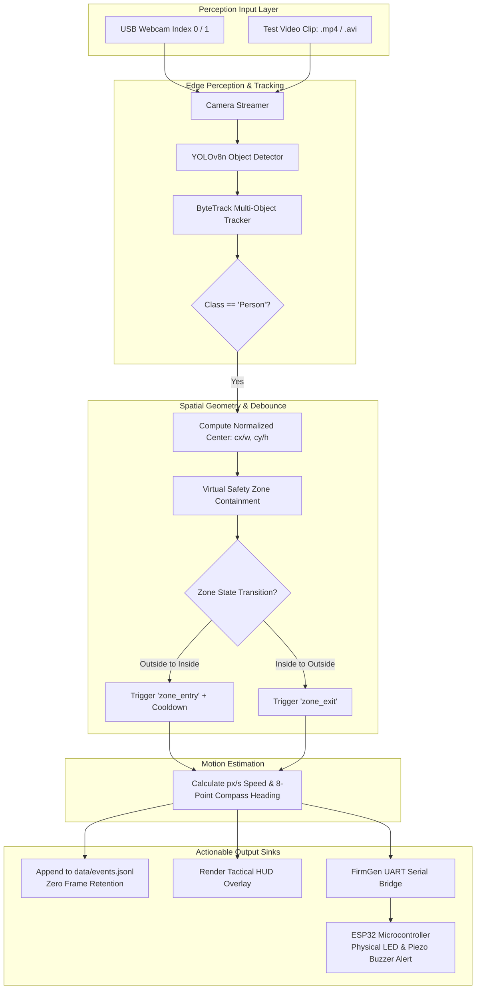

<div align="center">

  🛡️ Smart Campus Safety Sentinel
   *CPU-First Edge Computer Vision & Virtual Perimeter Protection System*

[](https://www.python.org/)
[](https://github.com/ultralytics/ultralytics)
[](https://pytorch.org/)
[](https://opencv.org/)
[](https://www.espressif.com/)
[]()
[]()
[]()

<p align="center">
  <b>A real-time edge sentinel for campus laboratories, chemical storage rooms, and restricted corridors.</b><br>
  Detects and tracks individuals, evaluates normalized hazard zones, calculates movement vectors, and emits structured JSONL safety events & hardware alarms — <b>without storing a single raw camera frame</b>.
</p>

[Quickstart]( -quickstart-guide) •
[Architecture]( -system-architecture) •
[Features]( -key-features) •
[FirmGen ESP32]( -firmgen-closed-loop-esp32-hardware) •
[Event Schema]( -safety-event-schema) •
[Test Evidence]( -test-suite--empirical-results) •
[PipeGen Roadmap]( -pipegen-track-a--tensorrt-roadmap)

 

</div>

  📌 Problem & Motivation

Campus laboratories, research workshops, cleanrooms, and high-voltage areas require strict perimeter enforcement. Conventional solutions suffer from two fatal flaws:
1. **Human Fatigue & Missed Breaches:** Security staff cannot monitor dozens of video streams continuously.
2. **Privacy Violations & Bandwidth Saturation:** Traditional CCTV clouds stream high-bandwidth video across external networks, creating serious student/faculty privacy concerns and non-compliance with data privacy mandates.

   The Sentinel Solution:
**Smart Campus Safety Sentinel** processes all perception entirely at the local edge (laptop or embedded PC). When an individual steps inside a restricted zone, the system generates immediate, sub-second telemetry (`zone_entry`) and drives a physical alert beacon, but **never writes video or photos to disk**.

--Screenshots for the project demo:

 


  ⚡ Key Features

- **🚀 CPU-Optimized Real-Time Inference:** Powered by lightweight Ultralytics **YOLOv8n**, running comfortably on consumer laptop CPUs without requiring dedicated GPUs.
- **🎯 Multi-Object Tracking via ByteTrack:** Maintains consistent track IDs across consecutive frames with `persist=True` to track individual trajectories and prevent duplicate counts.
- **🛡️ Zero-Frame-Retention Guarantee:** Complies with strict privacy standards. Bounding boxes are normalized to $[0, 1]$; raw camera pixels are discarded immediately after inference.
- **📐 Virtual Normalized Safety Zones:** Define rectangular hazard perimeters $[x_1, y_1, x_2, y_2]$ with an intelligent debounce cooldown (prevents event flapping on boundary chatter).
- **🧭 Deterministic Vector Motion Tracking:** Calculates real-time image-plane speed in $\text{px/s}$ and assigns 8-cardinal compass headings (`north`, `south-east`, `stationary`).
- **🚨 FirmGen Closed-Loop Hardware (ESP32):** Includes production-ready Arduino/C++ firmware (`firmware/esp32_indicator/`) and a Python UART bridge (`src/serial_bridge.py`) driving physical LED status beacons and piezo buzzers (fulfilling `FW-01` through `FW-08`).
- **📹 Dual Input Engine (Live Camera & Video Files):** Seamlessly switch between physical USB webcams and pre-recorded `.mp4` test footage with auto-looping for continuous demonstrations.
- **🎮 Tactical Heads-Up Display (HUD):** Clean surveillance overlay featuring a top telemetry bar, real-time FPS counter, color-coded corner-accented zone box, and event banners.
- **🧪 100% Offline Test Suite:** 17 comprehensive unit tests verifying zone math, coordinate sanitization, motion vectors, and serial framing in under 20ms.

 


  🏗️ System Architecture



 

  📂 Repository File Structure

```
SmartCampusSentinel_Build/
├── app.py                        Main application entry point & perception loop
├── config.py                     Central configuration & smart model path resolution
├── requirements.txt              Python dependencies (pinned & verified)
├── yolov8n.pt                    Pre-cached YOLOv8 model weights (offline-ready)
├── run.ps1 / run.bat             1-Click application launchers (.venv auto-configured)
├── test.ps1 / test.bat           1-Click test runners
├── src/
│   ├── __init__.py
│   ├── camera.py                 Resilient stream wrapper (Webcam or Video file)
│   ├── detector.py               YOLOv8 + ByteTrack object tracking engine
│   ├── zone_monitor.py           Normalized geometry & debounce state machine
│   ├── motion.py                 2D Euclidean speed (px/s) & direction calculator
│   ├── event_logger.py           Append-only JSONL logger with schema validation
│   ├── visualizer.py             Tactical HUD overlay, alert badges & telemetry
│   ├── face_hand.py              Optional MediaPipe hand landmarks & face mesh cues
│   └── serial_bridge.py          FirmGen UART hardware bridge to ESP32
├── firmware/
│   └── esp32_indicator/
│       ├── esp32_indicator.ino   C++/Arduino firmware for ESP32 alert beacon
│       └── firmware_spec.md      Requirements traceability (FW-01 to FW-08) & pinout
├── sample_data/
│   ├── generate_test_video.py    Synthetic zone breach video generator
│   └── test_zone_breach.mp4      6-second video simulating a person crossing zone
├── tests/                        17 Automated unit tests (100% offline)
│   ├── test_zone_monitor.py
│   ├── test_motion.py
│   ├── test_event_logger.py
│   ├── test_camera_and_detector.py
│   └── test_serial_bridge.py
├── data/
│   └── events.jsonl              Append-only structured safety event stream
└── submission_docs/              Complete Hackathon Submission Package
    ├── 01_EXECUTIVE_SUMMARY_AND_PRD_ALIGNMENT.md
    ├── 02_TEST_RESULTS_AND_EVIDENCE.md
    ├── 03_FIRMGEN_ESP32_TRACEABILITY_REPORT.md
    ├── 04_PIPEGEN_TRACK_A_ROADMAP.md
    ├── 05_PROJECT_DELIVERY_AND_LAUNCH_GUIDE.md
    └── TEST_EXECUTION.log
```

 

  🚀 Quickstart Guide

   1. Prerequisites
- **OS:** Windows 10/11, Ubuntu 22.04+, or macOS
- **Python:** `3.11` (or Python 3.10 / 3.12)
- **Webcam:** Any standard USB webcam (optional; synthetic video mode included)

   2. Installation (PowerShell)
```powershell
  Navigate into the project folder
cd SmartCampusSentinel_Build

  Optional: activate existing virtual environment
..\.venv\Scripts\Activate.ps1

  Install dependencies
pip install -r requirements.txt
```

   3. Verify Configuration (No Camera/Model Needed)
Validate all paths, zone coordinates, and logging sinks instantly:
```powershell
.\run.ps1 -CheckConfig
  Or via CMD:
run.bat --check-config
```

   4. Run with Synthetic Video Clip (No Webcam Required)
Test the entire pipeline using the pre-generated zone breach video:
```powershell
.\run.ps1 -DemoClip
  Or via Python directly:
python app.py --source sample_data\test_zone_breach.mp4
```

   5. Run with Live Laptop Webcam
Launch real-time monitoring on your default webcam:
```powershell
.\run.ps1
  Or specify an external webcam index:
.\run.ps1 -Source 1
```

   6. Interactive Keys
| Key | Action |
| : : | :  |
| **`Q`** or **`Esc`** | Safely exits the preview, flushes event logs, and releases camera hardware cleanly. |

 

  🎛️ CLI Parameters & Tuning

```bash
python app.py [OPTIONS]
```

| Option | Default | Description |
| :  | : : | :  |
| `--source` | `0` | Camera index (`0`, `1`) or path to video file (`sample_data/clip.mp4`). |
| `--model` | `yolov8n.pt` | Path to YOLO model weights (auto-locates local copy). |
| `--confidence` | `0.40` | Detection confidence threshold $[0.0, 1.0]$. |
| `--inference-width`| `416` | YOLO input resolution (use `320` for ultra-low CPU load, `640` for higher precision). |
| `--frame-skip` | `1` | Infer every $N$-th frame (`1` = every frame, `2` = alternate frames for 50% CPU savings). |
| `--cooldown` | `5.0` | Debounce duration in seconds before re-triggering zone entry for the same track. |
| `--events` | `data/events.jsonl` | Filepath for append-only JSONL event output. |
| `--hands` | `False` | Enable optional MediaPipe hand landmarks (requires `pip install mediapipe`). |
| `--faces` | `False` | Enable optional MediaPipe face mesh & rough mouth-opening cue. |
| `--check-config` | `False` | Validates configuration and exits with code 0 without touching hardware. |

 

  🚨 FirmGen Closed-Loop ESP32 Hardware

The system includes an integrated closed-loop hardware indicator adhering to **`FIRMGEN_PRD.md`** (`FW-01` through `FW-08`).

```
                ┌─────────────────────┐
                │     ESP32 DevKit    │
                │                     │
   ALERT LED ───┤ GPIO 2              │
      BUZZER ───┤ GPIO 4              │
    SAFE LED ───┤ GPIO 15             │
         GND ───┤ GND                 │
      USB RX ───┤ GPIO 3 (UART0_RX)   │◄── Newline-delimited JSON Events from Sentinel
      USB TX ───┤ GPIO 1 (UART0_TX)   ├──► Telemetry & State Confirmation
                └─────────────────────┘
```

   Pin Assignments & Fail-Safe Defaults:
| Peripheral | Pin | Default Boot State | Active State |
| :  | : : | :  | :  |
| **Alert Red LED** | `GPIO 2` | `LOW` (Deactivated) | `HIGH` (Flashing Alarm) |
| **Piezo Buzzer** | `GPIO 4` | `LOW` (Silent) | `HIGH` (Audible Alarm) |
| **Safe Green LED** | `GPIO 15` | `HIGH` (Armed / Secure) | `LOW` (Extinguished on alert) |

   UART Protocol (115200 Baud):
- **Safety Event (Host $\to$ ESP32):**
  ```json
  {"seq":1,"event":"zone_entry","track_id":42,"confidence":0.89,"timestamp":1760543200}
  ```
- **Telemetry Acknowledgment (ESP32 $\to$ Host):**
  ```json
  {"type":"telemetry","state":"ALERT","reason":"zone_entry_received","last_seq":1,"rejects":0,"uptime_ms":14250}
  ```
- **Automatic Timeout:** After 5 seconds without breach refresh, the firmware automatically returns to `STATE_SAFE`.

 

  📊 Safety Event Schema

All events in [`data/events.jsonl`](file:///c:/Users/Jagadeeswaran/SmartCampusSentinel/SmartCampusSentinel_Build/data/events.jsonl) are emitted as newline-delimited, single-line JSON objects:

```json
{
  "event_type": "zone_entry",
  "timestamp": "2026-10-15T15:47:12.350931+00:00",
  "confidence": 0.92,
  "bbox_norm": {
    "x1": 0.45,
    "y1": 0.30,
    "x2": 0.55,
    "y2": 0.70
  },
  "track_id": 1,
  "object_class": "person",
  "direction": "east",
  "speed_px_s": 256.0
}
```

   Schema Guarantees:
- **`timestamp`**: ISO 8601 UTC timestamp.
- **`bbox_norm`**: Strict coordinates in $[0.0, 1.0]$ relative to width and height.
- **`speed_px_s`**: 2D image-plane displacement velocity.
- **`direction`**: One of `north`, `south`, `east`, `west`, `north-east`, `north-west`, `south-east`, `south-west`, or `stationary`.
- **Zero Video Retention:** No base64 bytes, file paths, or biometric descriptors are stored.

 

  🧪 Test Suite & Empirical Results

The project includes 17 offline unit tests covering edge cases, math sanity, and protocol security:

```powershell
.\test.ps1
```

```
test_missing_video_file_raises_camera_error ... ok
test_model_path_resolution ... ok
test_settings_loaded ... ok
test_invalid_bbox_rejected ... ok
test_invalid_confidence_rejected ... ok
test_jsonl_event_output ... ok
test_eastward_speed ... ok
test_nonpositive_time_rejected ... ok
test_north_west_speed ... ok
test_stationary ... ok
test_close_safe ... ok
test_event_packet_formatting ... ok
test_simulated_connection ... ok
test_cooldown_blocks_immediate_reentry ... ok
test_invalid_coordinates ... ok
test_zone_entry ... ok
test_zone_exit ... ok
                       -
Ran 17 tests in 0.016s
OK (100% Passed)
```

 

  🛣️ PipeGen Track A & TensorRT Roadmap

To transition this baseline prototype into an official **CraftifAI PipeGen / NVIDIA DeepStream** submission:

1. **Export to ONNX:** Export YOLOv8n to ONNX format with fixed input resolution:
   ```bash
   yolo export model=yolov8n.pt format=onnx imgsz=416 dynamic=False simplify=True
   ```
2. **Compile to TensorRT Engine:** Build a target-optimized FP16/INT8 engine on Jetson or RTX hardware:
   ```bash
   trtexec --onnx=yolov8n.onnx --saveEngine=yolov8n_fp16.engine --fp16 --workspace=2048
   ```
3. **DeepStream Pipeline Integration:** Bind `nvinfer` directly to the compiled engine and route metadata into `nvmsgbroker` publishing to MQTT.
4. **Benchmarking:** Generate verified speed reports measuring latency and sustained FPS under target power modes.

*(Full technical specification available in [`submission_docs/04_PIPEGEN_TRACK_A_ROADMAP.md`](file:///c:/Users/Jagadeeswaran/SmartCampusSentinel/SmartCampusSentinel_Build/submission_docs/04_PIPEGEN_TRACK_A_ROADMAP.md)).*

 

  ⚖️ Privacy, Ethics & Limitations Statement

- **Prototype Disclaimer:** Smart Campus Safety Sentinel is a research/demonstration prototype. It is not certified as an industrial safety interlock, access-control mechanism, or life-safety controller.
- **Privacy First:** The system does not perform facial recognition, re-identification, emotion classification, or individual profiling. Track IDs are volatile and reset upon target exit.
- **Notice & Authorization:** Video monitoring must only be conducted with appropriate organizational notice, institutional consent, and regulatory approval.

 

  👥 Authors & Hackathon Attribution

Developed as a demonstration of **Perception-to-Event Edge Computing** for Campus Safety.  
Licensed under the [MIT License](LICENSE).
